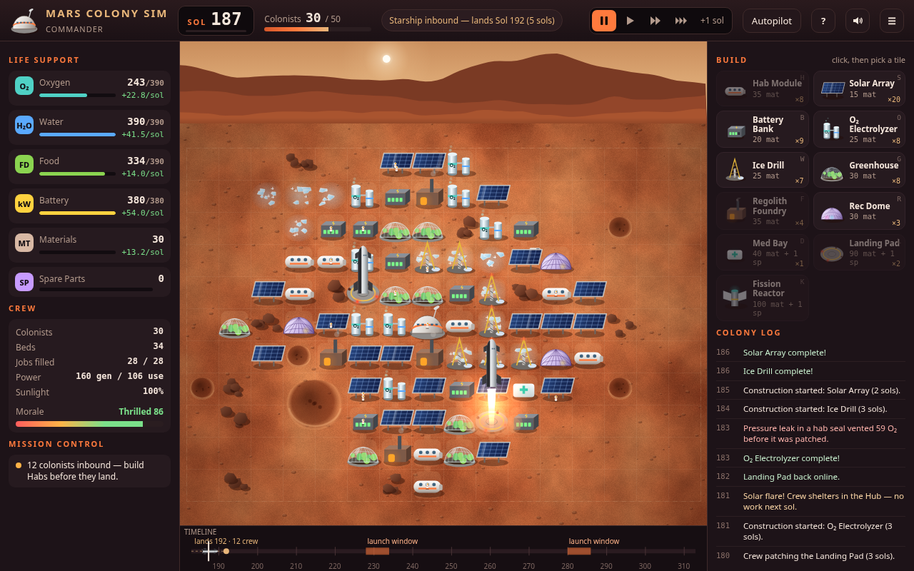

# Mars Colony Sim

An offline browser base-builder for the Boyd crew. You run a tiny Mars base: keep six colonists breathing, fed and happy, ride out dust storms, and use Starship launch windows to grow the colony to **50 people**.

Everything is one HTML file with no network requests, no accounts and no CDN fonts. Progress autosaves in `localStorage`. All numbers are made-up game numbers, not real-world data.



## The game

- **Life support:** each colonist uses 1 O₂, 1 water and 1 food per sol. **O₂ Electrolyzers** turn water into air, **Ice Drills** mine water (+50% on pale ice tiles), and **Greenhouses** grow food. Run out of air and people are lost within a sol or two. Water gives about 3 sols of warning and food about 5.
- **Power:** **Solar Arrays** charge **Battery Banks**. A dust storm cuts sunlight to 30%, and a global storm (after Sol 90) cuts it to 15%. You get a 3-sol warning before each storm. Life support always gets power before industry. At 12 colonists you unlock the **Fission Reactor**, which gives steady power through storms.
- **Habitat and crew:** **Hab Modules** give 4 beds plus tank space. **Rec Domes** and the **Med Bay** keep morale up. Unhappy crews work slower. If morale stays near zero for 8 sols, the crew mothballs the base and you lose.
- **Materials:** a **Regolith Foundry** turns dirt into building materials. **Spare parts** come only from Earth and give instant repairs.
- **Starship resupply:** a launch window opens every **52 sols** (standing in for "every ~26 months") and stays open for 6 sols. You pack each ship's manifest: colonists (max 6 per ship), life-support crates, food, materials and spares. Ships land 16 sols later. Each **Landing Pad** adds one more ship per window. Landings can go hard and crush some cargo, but the crew is always safe.
- **Events:** regional and global dust storms, meteorite strikes, equipment failures, solar flares, hab leaks, Hab Flu, dust devils that clean your panels, ice finds, salvage crates and morale boosts. Two events make you choose: Greenhouse Blight (purge or ride it out) and a Strange Glint (send a rover or stay home).
- **Win:** reach 50 colonists. **Gold** by Sol 200, **Silver** by Sol 260, **Bronze** any time after that. **Lose:** the whole crew is lost, or morale collapses.
- **Difficulty:** Cadet (good for Vic and Char), Commander (the recommended level) and Hardcore.
- **Autopilot:** the "Mission Control" planner can run the colony. It's fun to watch, and wins it gets are marked "assisted". The title screen shows it running a live demo colony behind the menu.
- **Polish:** procedural Mars terrain, a butterscotch day sky, blue-tinged dusks, a starry night with two tiny moons and glowing windows, storm haze, Starship landings with engine plume, meteor streaks, walking astronauts and rovers, a timeline strip showing launch windows, ships in transit and storms, and a forecast on every resource ("runs out in 6 sols"). Mission Control tips, WebAudio blips (press M to mute) and a full help screen are included too.

## Controls

| Action | Input |
|---|---|
| Build | Click a module card, then a free tile. **Shift-click** places several. Hotkeys: H Hab, S Solar, B Battery, O Electrolyzer, W Ice Drill, G Greenhouse, F Foundry, R Rec Dome, D Med Bay (doctor), L Landing Pad, K Reactor |
| Cancel / deselect | Right-click or `Esc` |
| Inspect / repair / recycle | Click a module. Repair instantly with 1 spare, or patch for 15 materials over 3 sols |
| Pause / speed | `Space`, then `1` `2` `3` |
| Advance one sol | `N` (or the **+1 sol** button) |
| Autopilot | `A` |
| Help / mute | `?` / `M` |
| Starship manifest | Opens automatically when a window opens. You can also click the orange chip in the top bar |

## Run

```bash
./run.sh start     # build + serve http://127.0.0.1:4353/  (health: /healthz)
./run.sh test      # build + smoke test (headless Chrome)
./run.sh balance   # scripted-strategy balance playtest (100 seeds per row)
./run.sh shots     # 1280x800 screenshots -> screenshots/
./run.sh all       # build + balance + shots + test + start
./run.sh stop
```

Offline single file: `dist/mars-colony.html` (with an identical `dist/index.html`). Double-click it to open in any browser. No server needed.

## Layout

| Path | Role |
|---|---|
| `web/engine.js` | Pure, deterministic game engine (seeded RNG stored in the save) plus the Mission Control autopilot. Shared by the browser and Node |
| `web/render.js` | Canvas art: terrain, sky, modules, Starship, astronauts, rovers |
| `web/app.js` · `index.html` · `app.css` | UI, game loop, modals, input, sound, save, and the `window.__MC__` test API |
| `build.py` | Inlines web/ into `dist/mars-colony.html` |
| `server.py` | Stdlib server on port **4353** |
| `tests/smoke_test.py` | Offline-bundle checks, engine sanity and a headless Chrome playthrough (`tests/play.mjs`, CDP via `tests/cdp.mjs`) |
| `tests/balance.mjs` | Automated balance playtest. Writes `tests/balance_results.{json,md}` |
| `tests/shots.py` · `tests/_shots_run.mjs` | Screenshots. Copies the hero shot to `screenshots/00-best-starship-landing.png` |

## Test results (2026-10-15)

`./run.sh test` gives **RESULT: 52/52 checks passed**. The checks:

- Bundle is self-contained: no external tags or URLs, no fetch/XHR/WebSocket, and Chrome logged **0 network requests** and **0 JS errors**.
- Engine: autopilot wins Commander on 10/10 seeds, an idle colony fails on 10/10 seeds, and the same seed with the same moves replays the same game.
- Browser playthrough:
  - Starting from the title card works. A real mouse click on the map places a Hab, which spends 35 materials and finishes in 3 sols.
  - Rocks and craters can't be built on. The sol counter advances by step and in real time.
  - The launch window opens on Sol 20 with the manifest dialog, steppers set the cargo, and a 7th colonist is refused. Launch, then landing 16 sols later, adds the colonists and parks the ship on its pad.
  - A dust storm gives a 3-sol warning, then cuts solar from 24.0 to 7.2.
  - Failure, then click, inspector and spare-part repair all work. Choice events pause the game and resolve.
  - Save → reload → Continue works.
  - **Loss paths:** neglect fails (Sol 39, crew lost) and losing oxygen kills the crew (Sol 6). Both show the "Mission Failed" dialog.
  - **Win path:** autopilot reaches 50 colonists on Cadet (Sol 192) and Commander (Sol 244), and the victory dialog shows a medal.

## Balance playtest

`node tests/balance.mjs 100` runs five scripted strategies on 100 seeds per difficulty with the real engine:

Balance playtest: 100 seeds per row, max 900 sols, run 2026-10-15 17:17 UTC (10.2s)

| Strategy | Difficulty | Win rate | Median win sol | Median loss sol | Avg crew lost | Medals (G/S/B) | Loss reasons |
|---|---|---|---|---|---|---|---|
| Idle (never touches anything) | cadet | 0% | - | 124 | 19.4 | 0/0/0 | crew lost 97, morale collapse 3 |
| Idle (never touches anything) | commander | 0% | - | 63 | 12.1 | 0/0/0 | crew lost 96, morale collapse 4 |
| Idle (never touches anything) | hardcore | 0% | - | 61 | 8.6 | 0/0/0 | crew lost 100 |
| Colonist rush (habs + pads, all-colonist ships) | cadet | 0% | - | 148 | 39.2 | 0/0/0 | crew lost 99, morale collapse 1 |
| Colonist rush (habs + pads, all-colonist ships) | commander | 0% | - | 56 | 14.3 | 0/0/0 | crew lost 100 |
| Colonist rush (habs + pads, all-colonist ships) | hardcore | 0% | - | 45 | 11.1 | 0/0/0 | crew lost 100 |
| Novice rotation (builds a fixed cycle, no forecasting) | cadet | 100% | 192 | - | 0 | 100/0/0 | - |
| Novice rotation (builds a fixed cycle, no forecasting) | commander | 64% | 244 | 171 | 38.3 | 21/32/11 | crew lost 33, morale collapse 3 |
| Novice rotation (builds a fixed cycle, no forecasting) | hardcore | 11% | 244 | 174 | 42.1 | 0/6/5 | crew lost 83, morale collapse 6 |
| Casual (Mission Control logic, checks in every 7 sols) | cadet | 100% | 197 | - | 0 | 100/0/0 | - |
| Casual (Mission Control logic, checks in every 7 sols) | commander | 100% | 247 | - | 0.1 | 19/78/3 | - |
| Casual (Mission Control logic, checks in every 7 sols) | hardcore | 88% | 296 | 216 | 7.1 | 0/41/47 | crew lost 8, morale collapse 4 |
| Mission Control autopilot (acts every sol) | cadet | 100% | 192 | - | 0 | 100/0/0 | - |
| Mission Control autopilot (acts every sol) | commander | 100% | 192 | - | 0.6 | 63/36/1 | - |
| Mission Control autopilot (acts every sol) | hardcore | 83% | 296 | 218 | 12.6 | 0/39/44 | morale collapse 9, crew lost 8 |

Takeaways:

- Doing nothing, or rushing colonists without building life support, always fails. Neglect lasts about 60 sols on Commander.
- A naive fixed build order beats Cadet every time, wins 64% on Commander and wins only 11% on Hardcore. That spread is the intended difficulty curve.
- Forecasting play (the Mission Control logic) wins Commander every time, even checking in only every 7 sols. Hardcore stays hard: about 83–88% wins, mostly Silver/Bronze, with real crew losses.
- On Commander, Gold (by Sol 200) needs near-perfect play: 4 landing pads ready by the 4th window.

Tuning history: the first pass let Commander lose whole colonies in one global storm, because power was shared equally and losses came in big chunks. Life support now gets power priority, losses are dice-rolled based on how short you are, ships carry at most 6 colonists, and production numbers were lowered. Hab tanks were added so stockpiles can't grow forever.

## Notes

- Balance comes from scripted strategies, not human playtesting. Commander for a first-time human probably plays harder than the "novice rotation" bot, which is why Cadet exists.
- Sizing targets 1280×800 and larger. It works on smaller screens but isn't phone-optimized.


---
## Repo notes
- **Built:** 2026-10-15, by TokenMax (Boyd's Grok Bot) on the Grok Bot box.
- **Run:** `./run.sh` (then open the localhost URL it prints).
- Imported from `/workspace/tokenmax/mars-colony` on Oct 23, 2026. node_modules, virtualenvs, logs and files over 20 MB were left out.
